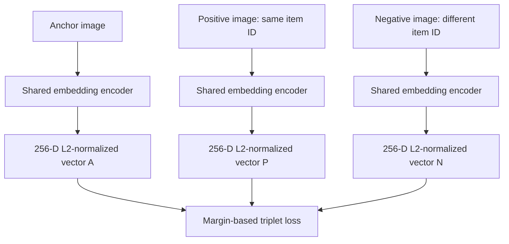
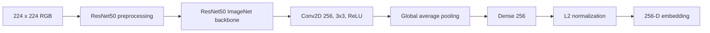
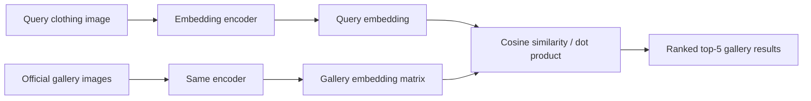
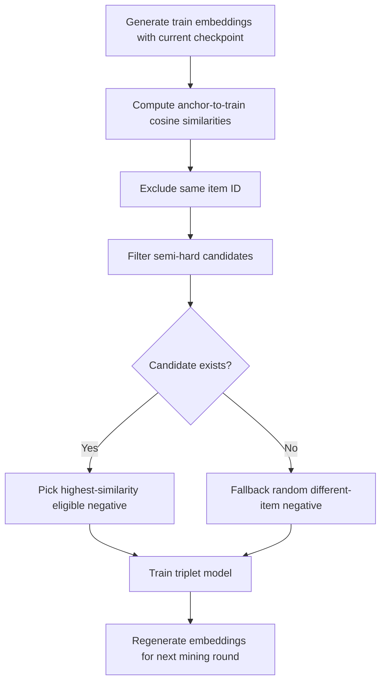

# Architecture and training workflow

## Shared encoder and triplet training

The three encoder boxes represent **the same model with shared weights**, not three independently trained networks. The model source is `fashion_assistant/model.py`.

## Encoder internals

Training loss uses squared Euclidean distances between unit-normalized embeddings:

`max(0, ||A-P||² - ||A-N||² + 0.2)`

## Inference and retrieval

The current project uses an in-memory gallery embedding matrix, not a vector database. Because vectors are L2-normalized, their dot product equals cosine similarity.

## Semi-hard negative mining

In the supplied miner, candidates satisfy `positive_similarity - 0.2 < negative_similarity < positive_similarity`, with a different-item constraint. **Important:** The cosine-similarity window is not mathematically identical to the triplet loss margin `0.2` in squared Euclidean distance; it is a mining heuristic.
