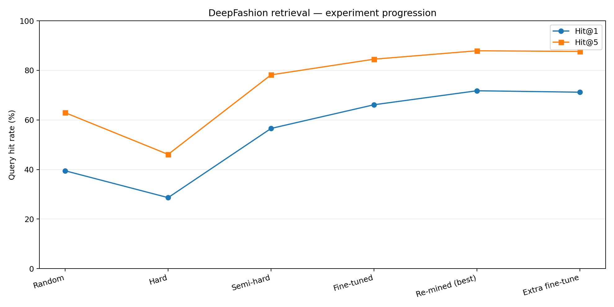

# Experiment log and results

Results below were supplied during the project development conversations. The uploaded source ZIP contains the training/evaluation scripts but not the trained weights, raw dataset, or immutable experiment manifests. These are **reported measurements**, not newly rerun or independently verified scores.

| Experiment | Precision@5 | Recall@5 | Hit@1 | Hit@5 |
|---|---:|---:|---:|---:|
| Random negatives | 19.60% | 28.41% | 39.48% | 62.93% |
| Hard negatives | 13.15% | 19.84% | 28.64% | 46.10% |
| Semi-hard negatives | 27.66% | 40.49% | 56.57% | 78.20% |
| ResNet50 fine-tuning | 31.53% | 46.93% | 66.13% | 84.53% |
| Refreshed semi-hard mining (best) | 35.28% | 51.34% | 71.78% | 87.92% |
| Further fine-tuning (latest) | 35.35% | 51.20% | 71.20% | 87.66% |

## What changed and why

1. **Random negatives:** pretrained ResNet50 frozen; train custom projection head with triplet loss.
2. **Hard negatives:** pick highly similar different-item examples. Performance decreased, illustrating that the hardest negatives are not always the most helpful.
3. **Semi-hard negatives:** use embedding similarity to select negatives that are close to, but less similar than, the positive. Performance improved.
4. **Backbone fine-tuning:** unfreeze the last 30 ResNet50 layers except BatchNormalization, train with a smaller learning rate (`1e-5`).
5. **Re-mine and fine-tune:** regenerate train embeddings from a stronger checkpoint and refresh semi-hard triplets. Best reported retrieval score: **71.78% Hit@1 and 87.92% Hit@5**.
6. **Additional 10 epochs:** training loss decreased further, but Hit@1 declined to 71.20% and Hit@5 to 87.66%. We retained the earlier best reported model.

## Latest 10-epoch loss history

`0.03745, 0.00814, 0.00465, 0.00357, 0.00314, 0.00265, 0.00223, 0.00214, 0.00175, 0.00180`

The checkpoint monitored training loss and selected epoch 9. This is **not** a retrieval-based validation selection.

## Interpretation and limitations

- Evaluation uses 14,218 query images, official gallery identities, and top-5 rankings.
- Precision@5 counts the fraction of the five returned images sharing the query item ID. Recall@5 divides the number of matching returned images by the number of available gallery images for that item. Hit@1 / Hit@5 indicate whether at least one same-item match appears in the first 1 / 5 results.
- The official query/gallery evaluation was consulted repeatedly during model development. Consequently, these are not results from a pristine, untouched final test set; future work should reserve a separate validation/test protocol.
- Same-item retrieval does not necessarily equal matching visual color or subjective style. The system does not claim to recommend complementary outfits.
- No confidence intervals, multi-seed results, public benchmark comparison, production latency, or user-generated-photo validation are provided.
- **Do not assume** the latest epoch-9 checkpoint is the best retrieval checkpoint. The reported 71.78% result was from an earlier training round.
